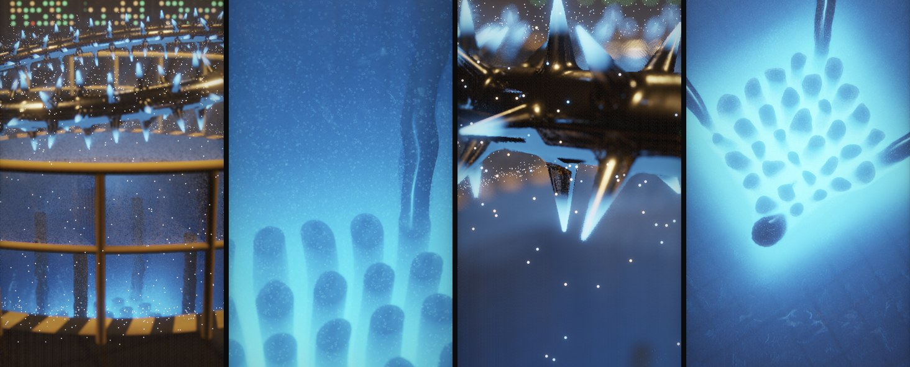
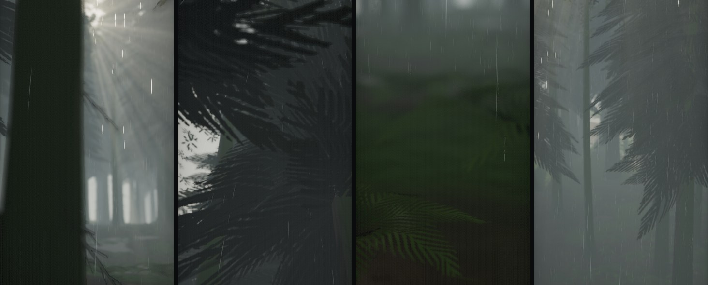
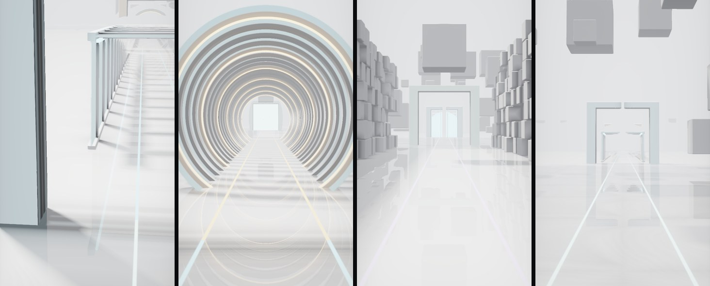
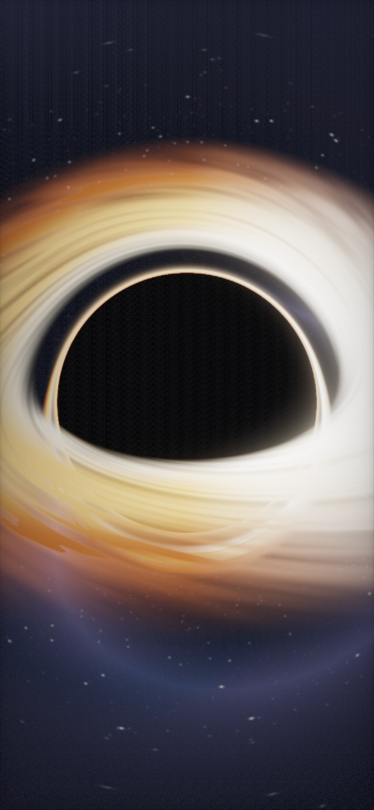
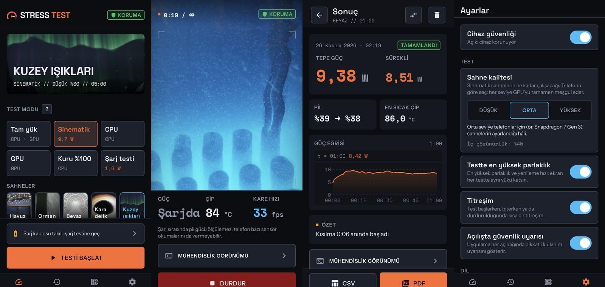

<div align="center">

# Stress Test

**An engineering test tool for Android phones: it loads a phone up to the most power it can really draw, and measures its power, heat and performance.**

[](https://github.com/OzcanOrhanDemirci/stress_test/actions/workflows/ci.yml)
[](https://github.com/OzcanOrhanDemirci/stress_test/actions/workflows/release.yml)
[](https://kotlinlang.org)
[](https://developer.android.com/compose)
[](app/src/main/cpp)
[](app/src/main/cpp/cpu)
[](app/src/main/cpp/gpu)
[](app/build.gradle.kts)
[](#the-reference-device)
[](https://github.com/OzcanOrhanDemirci/stress_test/releases/latest)
[](LICENSE)

**10.1 W** at full load on the reference phone · **2.6×** the power of an "idle 100 %" on the same cores · five cinematic scenes at three quality levels · charge test · device safety · a PDF report

**[Download the latest package](https://github.com/OzcanOrhanDemirci/stress_test/releases/latest)** · 64-bit Android 10 and above · no network access, nothing collected

[Install](#install) · [Compatibility](#compatibility) · [The question](#the-question) · [Results](#results) · [Modes](#modes) · [Charge test](#charge-test) · [Scenes](#the-cinematic-scenes) · [The app](#the-app) · [Device safety](#device-safety) · [How it measures](#how-power-is-measured) · [How it loads](#how-the-load-is-made) · [Architecture](#architecture) · [Building](#building)

*[Türkçe](README.tr.md)*

<br />


</div>

---

**Stress Test is an engineering tool for examining an Android phone's power,
heat and performance.** It is not a game, and it is not an app for entertainment
or everyday use. It deliberately runs the phone at full load, makes it very hot
and drains its battery quickly, so that what the phone does under that load can
be measured and compared. Even the cinematic scenes are a graphics load with
their frame rate measured, not a show.

It measures how much power the phone draws under load and how much reaches its
battery while charging. The **Honor 400** is the reference
device. The power figures below come from that phone, and its measurements
guided the choice of stress loads.

> [!WARNING]
> Stress Test runs a phone at full capacity, and the phone gets very hot.
> [Device safety](#device-safety), on by default, stops a test before the
> battery, the case or the chip gets dangerously hot, but it reads the phone's
> own sensors and cannot guarantee protection. Run tests out of the case, on a
> flat, cool surface, and use the app at your own risk: it comes with no
> warranty ([licence](LICENSE)).

## The question

Most stress tests on a phone report the same thing: every core at 100 %. That
number says how busy a core is, not how hard it is working. A core can be fully
occupied by a chain of dependent integer additions and leave almost all of its
units idle; it can also be kept busy by vector multiply-adds streaming operands
from the cache, with the arithmetic units, the load path and the cache all
running at once. Both read as 100 %. Only one of them heats the phone.

It is the difference between Cinebench and Prime95, and this project measures
it. On the reference phone:

| What runs on all eight cores | Reported load | Battery power |
| --- | --- | --- |
| Dependent integer additions (`dry`, the "idle 100 %") | 100 % | **2.46 W** |
| FP32 fused multiply-add, operands streamed from L2 (`fp32_l2`) | 100 % | **6.39 W** |
| The same, plus the GPU's FP32 burner (**Full load**) | 100 % + GPU 100 % | **10.1 W** ¹ |

<sub>The first two rows are one session, at room temperature: the same 100 %, 2.6 times the power.
¹ Measured in a later session with the phone on a metal plate in front of a fan, which sustains
more power; in that session `fp32_l2` alone drew 7.10 W.</sub>

So the single criterion here is **power drawn from the battery, in watts**. A
load is only "the maximum" if nothing measured draws more. The phone's own
governors do whatever they do, and the result screen shows when and how much.
Since 0.2.0 the app also guards the phone by default ([device safety](#device-safety)):
it stops a test before the battery, the case or the chip gets dangerously hot.
Switched off, it steps aside entirely.

The same lesson turned up on the GPU later. A ray-marched scene keeps the GPU
100 % busy yet draws 2.95 W; an FP32 multiply-add burner on the same GPU draws
5.45 W. Busy is not working, there either.

## Results

All figures are battery power from Android's `BatteryManager`, measured with the
phone unplugged, in sessions the phone runs by itself (see
[How power is measured](#how-power-is-measured)). The full record, with every
session's conditions, is in [docs/OLCUMLER.md](docs/OLCUMLER.md).

**CPU kernels, all eight cores, mean of the first 30 s, two tests each in random order, room temperature:**

| Kernel | What it exercises | Power |
| --- | --- | --- |
| `fp32_l2` | FP32 FMA, operands streamed from a 256 KiB buffer | **6.39 W** |
| `i8_mmla` | INT8 matrix multiply-accumulate (SMMLA) | 5.27 W |
| `fp64_gemm` | FP64 FMA, 8×6 outer product from L1 | 5.08 W |
| `mixed` | FMA, integer chain, multiplier and stores at once | 4.95 W |
| `bf16_mmla` | BF16 matrix multiply-accumulate (BFMMLA) | 4.80 W |
| `fp32_dram` | FP32 FMA, operands streamed from 32 MiB | 4.76 W |
| `fp32_gemm` | FP32 FMA, 8×12 outer product from L1 | 4.54 W |
| `memcopy` | Copying 32 MiB: pure memory bandwidth | 4.13 W |
| `i8_dot` | INT8 dot product (SDOT) | 3.95 W |
| `fp32_reg` | FP32 FMA in registers only | 3.93 W |
| `dry` | Dependent integer additions | **2.46 W** |

Two things stand out. Arithmetic alone is not what draws the power:
register-only FMA keeps the FMA units full and stays at 3.93 W. Moving the data
is. And the buffer has a sweet spot: the same kernel draws 6.62 W at 128 KiB,
**7.10 W at 256 KiB**, 6.82 W at 512 KiB, then falls to 4.8 W at 1 and 2 MiB,
where the cores mostly wait for memory. (The second set of numbers comes from a
session with the phone on a metal plate in front of a fan, which sustains more
power; within a session the ranking is what counts.)

**GPU burners, alone:** FP32 ALU 5.57 W · FP16 ALU 3.70 W · blending 3.09 W ·
texture sampling 3.03 W · memory bandwidth 2.73 W.

**Together:** `fp32_l2` on the CPU with the FP32 burner on the GPU is the
highest measured, **10.09 W and 10.13 W** in two sessions. The CPU gives up some
frequency to the shared budget (A510 / A715 / prime settle near
1.1 / 1.8 / 2.1 GHz) and the total is still the highest.

## Modes

| Mode | Load | On the screen | Measured |
| --- | --- | --- | --- |
| **Full load** | `fp32_l2` + GPU FP32 burner | a load gauge (the burner keeps the GPU) | **10.1 W** |
| **Cinematic** | `fp32_l2` + a scene | one of five scenes, chosen on the home screen | 8.9 W with the pool |
| **CPU** | `fp32_l2` on all cores | a gauge | 7.1 W (6.4 W uncooled) |
| **GPU** | GPU FP32 burner | a load gauge | 5.5 W |
| **Dry 100 %** | `dry` | a gauge | 2.5 W (uncooled) |
| **[Charge test](#charge-test)** | phone left idle while charging | power into the battery by charge level | varies with the phone, charger and cable |

<sub>Stress-test power was measured on the Honor 400 on a metal plate in front of a fan unless marked uncooled.</sub>

A stress test lasts 1, 5, 15 or 30 minutes, or until stopped. It starts with 10 seconds at
rest to measure what the phone draws doing nothing, then drives the display at
full brightness and its highest refresh rate, the same way every time, so tests
compare.

Why the scenes are a mode of their own rather than the background of Full load
is a measured decision: with the scene on screen, the burner has no frame time
left and full load drops to 8.97 W, 88.5 % of the maximum. The rule written
before the measurement was 97 %, so the scenes became their own mode
([docs/PLAN.md](docs/PLAN.md), §13/7).

An optional setting lets the FP32 burner use spare frame time in cinematic tests.

### Charge test

The charge test multiplies battery current by battery voltage and plots the net
power reaching the battery, in watts, against its charge percentage. The
charger also powers the phone and covers losses in the charging circuit. The
test cannot measure either the charger's output or those losses.

Select **Charge test** and leave the phone idle. Choose 5, 15 or 30 minutes, or
**Until full**. Starting between **20% and 50%** makes differences easier to see
before the phone slows charging. For a 20-second idle measurement, start
unplugged and connect the charger when prompted. When power reaches the battery,
the app adds the measured idle draw, if available, and labels the result **Into
the phone (estimate)**. The estimate excludes charging-circuit losses. You can
also start with the charger connected. The test needs usable current and voltage
readings to show power.

To compare chargers or cables, change one at a time, start at a similar battery
level and temperature, and compare the curves at the same battery percentage.
The results are saved in History and can be exported as CSV.

## The cinematic scenes

The second goal of the project, added halfway: *the most impressive picture the
phone can show*. At Medium quality each scene is rendered at 45 % of the screen's
resolution and built up to full resolution over time: every frame moves its samples by a
sub-pixel jitter and reseeds its random effects, a temporal pass reprojects the
previous frames with the camera and clips them against the new one, and a
Catmull-Rom filter scales the result to the screen. The phone's GPU has about
1 TFLOPS of arithmetic but only about 16 GB/s of memory bandwidth, so every
effect is chosen to cost arithmetic rather than memory.

### Pool



A research reactor seen from its pool deck. One full-screen ray-marching shader
draws the hall, the spiked containment ring and the fuel assembly glowing
Cherenkov blue under the water. The water surface is a 256 × 256 height field
solved with the wave equation 60 times a second on the GPU: bubbles bursting
over the core start rings that cross, reflect off the pool wall and scatter round
the control-rod tubes, and the surface bends the light into caustics on the
floor. 16,384 GPU particles (rising bubbles, sparks circling the ring), bloom,
depth of field per shot, and a pulse: once a loop the reactor flashes as a TRIGA
does.

### Forest



A temperate rain forest after rain. Unlike the pool this one is geometry: up to
676 spruce and beech on a jittered grid, their branches and needle sprays, ferns
and fallen trunks.
None of it is stored. A vertex shader builds every vertex from its draw and
instance numbers (vertex pulling), and a fragment shader cuts each card to the
outline of a spray of needles or a cluster of leaves. The sun's shadow map is
drawn once; a light pass walks each pixel's ray through the mist against it and
draws the shafts of light. 8,192 rain streaks catch the light inside the beams,
and rings spread on the puddles.

### White



About clarity rather than drama: an endless white space, a polished floor that
mirrors everything, and a camera flying without a cut through a void of floating
cubes, a glass corridor, a ribbed glass tunnel and a room walled with stacked
cubes. The glass is thin and pale green-blue, deeper at a slant, so the vast
white world stays in view through it. No depth of field, no colour fringing, no
grain, almost no bloom, and a light sharpening on top of the upscale.

### Black hole



Where the other scenes march surfaces, this one integrates each ray's fall.
A supermassive black hole burns an accretion disk in deep space, and every
pixel steps its own light through the hole's field: bent round it, wound
round it, lost in it. The bending is the picture: the disk's far side rises
over and under the shadow, a thin ring of orbits hugs the edge, and the
starfield doubles around it. Nothing is stored and nothing is sampled; the
whole scene is the arithmetic of the integration (Runge-Kutta, an adaptive
step, hashes for the stars and the disk's turbulence). Quality grows the
fall's step budget, the samples a pixel takes, the disk's turbulence and
the density of the sky. High more than doubles the step budget and takes two
samples a pixel. The image above is the desktop preview running the phone's
shaders.

### Northern lights


A polar night in a fjord, and the first scene whose hero is the sky. Green and
violet curtains of aurora ripple over snowy mountains and the stars, and the
still water and black ice give them back. The curtains are thin sheets, and
each ray's path through them is integrated in closed form: a Gaussian sheet
seen along a straight line is a difference of two error functions. A fold seen
edge-on therefore glows brighter, as a real one does, and no curtain can fall
between two steps. The mountains are a ridged heightfield marched per pixel
and lit by a low moon with its soft shadow; the water mirrors the whole scene.
Fine detail fades with each pixel's footprint, so the far ridges and the
curtains' rays do not shimmer while the camera drifts. Quality grows the
curtains' steps, the mountains' octaves and the march budget, and High takes
two samples a pixel. The images are the desktop preview running the phone's
shaders.

### Graphics quality

Low renders at 30% of screen resolution and Medium at 45%. High adds detail and
renders at 65%, or 100% for the forest. The Honor 400 drew all five scenes at
their requested settings in 15-second lab tests with only the scene active and
zero errors. Times are in milliseconds per frame. [Measurement log](docs/OLCUMLER.md)

| Quality | Pool | Forest | White | Black hole | Northern lights |
| --- | ---: | ---: | ---: | ---: | ---: |
| **Low** | 25.9 | 26.7 | 20.3 | 12.9 | 19.2 |
| **Medium** | 48.5 | 41.4 | 38.7 | 25.3 | 46.9 |
| **High** | 295-311 | 137.6 | 174.2 | 122.3 | 336.6 |

At startup the app checks whether the GPU can draw the requested settings
without risking a driver reset from a very long frame. If it has to reduce the
quality or resolution scale, the live test and result show what was drawn. The
record keeps both settings, and the test is excluded from comparisons and the
Honor 400 reference line.

## The app



The interface puts live measurements up front in flat graphite panels. Use the
four tabs to start a test, open History, inspect the Device readings or change
Settings. During a stress test, the scene or gauge stays in view with the live
readings. The result shows peak and sustained power, average,
idle, energy used, the battery before and after, how long a full battery would
last at this load, the hottest chip, the CPU and GPU work rates, the scene's frame
rate, stability and computation errors, then an **analysis** in plain words (when
the phone first throttled, how much speed it gave up between the first minute and
the last, how hot the chip and the battery got, how fast the battery drained) and
charts of power, temperature, clocks, work and frame rate that read out their
values under a finger. Eligible stress tests can be **compared** side by side.
Stress results can be exported as a two-page **PDF report** or as **CSV**.
Where a bundled Honor 400 measurement is available, the result includes it for
reference. The pool reference was measured at Medium with the extra burner off.
History keeps the newest 200 tests. The app follows the phone's language unless English or
Turkish is selected in Settings or, on Android 13 and later, in the phone's
per-app language settings.

## Install

1. Download `stress-test-<version>.apk` from the
   [latest release](https://github.com/OzcanOrhanDemirci/stress_test/releases/latest).
2. If you want to be sure it came from here, check what signed it
   ([SECURITY.md](SECURITY.md#verifying-a-package) has the certificate).
3. Open it on the phone, and allow installing from that source when Android
   asks.

See [Compatibility](#compatibility) for phone requirements. The app cannot
reach the network. Its one permission is for notifications, asked for when a
charge test starts on Android 13 and later, and used only to say that the test
filled the battery; declining it changes nothing else. A package built from this source
without the release key is signed with a debug key, and the two cannot update
each other: uninstall one before installing the other, which also removes its
test history.

## Compatibility

Stress Test is designed for 64-bit ARM phones (`arm64-v8a`) with **Android 10 or
later**. The compatibility work covers Snapdragon/Adreno, MediaTek and Exynos
devices with Mali, Google Tensor, Exynos with Xclipse, and PowerVR GPUs. GPU-based
tests, including Full load and Cinematic, need a usable Vulkan 1.1 or newer
driver. Without one, the CPU and charge tests are still available.

The app works out how the battery gauge reports current, checks vendor-specific
thermal zones and performance counters, and adapts to differences in CPU
instructions and Vulkan drivers. When a reading is missing or unusable, the app
shows **N/A** (**Yok** in Turkish). The **Device** tab explains what the phone lets the app read and why
a reading is missing, for example when the driver exposes no GPU counter.

The **Honor 400 is the only phone tested in hand**. Compatibility elsewhere is
based on code review and known vendor differences. There was no device farm or
paid testing.

## Device safety

On by default, and the first thing on the settings screen. While a test runs the
app watches the phone and stops the test when a reading stays past its limit for
three seconds; the test is kept, with the reason and the reading.

| Stops at | Warns at | Does not start above |
| --- | --- | --- |
| battery 47 °C | 44 °C | 42 °C |
| CPU or GPU 110 °C | 105 °C | 80 °C |
| case 48 °C | 45 °C | 42 °C |
| Android thermal status *severe* | *moderate* | *severe* |
| battery 5 % (on battery) | 10 % | 10 % |

The chip limit sits above the throttling point on purpose: the Honor's kernel
starts throttling its CPU and GPU zones at 95 °C (its harder limits are 110 to
115 °C, critical 125 °C), so stopping at 95 °C would end every full-load test
within seconds. It does not always hold them there either: in one full-load test
it released the GPU's throttling after 37 seconds and let it reach 107 °C, and the
first limit, 105 °C, ended that test at 43 seconds. The stop is now at 110 °C,
where the phone's own harder stage begins, with a warning from 105 °C: it is for a
phone whose own protection is no longer keeping up. Turning device safety off asks first; off,
the app never steps in and only the phone's own protection remains. In the first
real stop, a forest test on the charger ended at 2:36 when Android reported a
*severe* thermal status; the owner's own 34-minute full-load test, made before the
feature existed, had taken the battery from 43 to 55 °C.

Each time the app opens, a notice says so plainly: a test runs the phone at full
capacity and makes it very hot, device safety cannot guarantee protection, and the
responsibility is the user's. It closes only when accepted; "don't show again"
turns it off, and the settings turn it back on.

## How power is measured

The phone gives an app no access to its battery sysfs; the only source is
`BatteryManager`. Its fields on the reference phone needed measuring before they could be
trusted:

- `CURRENT_NOW` is in **milliamperes** (not microamperes), negative while
  discharging, updated once a second. The app infers the unit and the sign from
  the readings rather than assuming them.
- `CHARGE_COUNTER` is in **milliampere-hours** (not microampere-hours) and moves
  every 30 seconds or so; the voltage arrives only with the battery broadcast,
  about as often. A unit assumption here once made the battery-life estimate
  wrong by a factor of a thousand.
- A plugged-in sample is invalid for measuring power drawn from the battery.
  The [charge test](#charge-test) measures power in the other direction.

A sampler reads power, every thermal zone, the frequency of each cluster and the
GPU's busy counter ten times a second and keeps a bounded log.

**Comparing loads fairly** needs the cable out (a charging battery says nothing
about what the phone draws), and the reference phone drops adb over TCP and wireless
debugging alike the moment the cable is unplugged. So comparisons run as **lab sessions** the phone runs by itself:
`tools/lab.mjs` starts a session over the cable, the phone waits until it is
unplugged, then for each load in random order it waits until its CPUs have
cooled below a set temperature, measures 10 seconds at rest and 60 seconds under
load, and saves the samples. Plugged back in, `lab.mjs pull` and `report`
bring the results back and rank them.

## How the load is made

**CPU.** Eleven kernels, plus four buffer-size variants of the winner, written
in AArch64 assembly by a generator (`tools/gen_kernels.py`) so that every one has
the same signature and the same discipline:

- Each batch of iterations ends in a **digest** of its results, compared against
  a golden value. A kernel that heats the phone by computing the wrong thing is
  caught: computation errors are counted and shown with every test.
- Workers are **pinned** to their core. Qualcomm's `core_ctl` parks big cores
  at idle and sometimes under load, so pinning is retried every batch and
  misplaced batches are counted.
- A workload is written as text, `0-3:i8_mmla,4-7:fp32_l2+gpu_fp32`, so the same
  string drives the app's modes, the lab sessions and the tests.

**GPU.** A Vulkan 1.1 engine (with 1.2 features where present) and five burners: FP32 and FP16 arithmetic,
texture sampling, memory bandwidth and blending. Three frames are kept in
flight; three timestamps split every frame into burner time and visible-pass
time, and the number of burner dispatches is sized each frame so that burner
plus scene fill the target frame time. Each dispatch's results are checked
against the first. One driver behaviour had to be found by bisecting a shader:
the Adreno 720 driver refuses a compute pipeline that copies a whole struct out
of a storage buffer (`VK_ERROR_UNKNOWN`); `particle_params.glsl` explains it, and
every pipeline that fails to build is now named in the log.

## Architecture

```
app/src/main
├── java/dev/ozcan/stress
│   ├── engine/      CPU and GPU engines, the workload grammar, scene quality
│   ├── telemetry/   the 10 Hz sampler, battery and thermal readers, sysfs layout, core names
│   ├── device/      what the phone is: chipset, clusters, GPU, Vulkan version
│   ├── analysis/    power, windowed statistics, work rates, findings, comparisons
│   ├── safety/      device safety: limits, findings, the monitor
│   ├── settings/    the user's choices
│   ├── run/         a stress test: modes, the controller, analysis, records and their store
│   ├── charge/      charge sessions, battery power and analysis
│   ├── report/      the PDF report and the CSV
│   ├── lab/         self-running comparison sessions: specs, runner, analysis, CSV
│   └── ui/          Compose: navigation, components, home, run, result, charge, compare, history, settings, device
└── cpp
    ├── cpu/         the kernels (generated AArch64 assembly), their table, the worker threads
    ├── gpu/         the Vulkan helpers, the burner engine, the cinematic scene renderer
    │   └── shaders/ GLSL: burners, the five scenes, TAA, bloom, depth of field, the finish
    ├── sense/       a native reader for thermal zones, frequencies and the GPU's busy counter
    └── jni_bridge.cpp
tools/
├── gen_kernels.py   writes the kernels' assembly
├── lab.mjs          starts lab sessions, pulls their results, ranks them
└── scene_preview.py renders the scenes on the development machine's GPU
docs/
├── PLAN.md          the plan, the device's measured facts, every decision and its reason
└── OLCUMLER.md      every measurement, with its conditions
```

The scene shaders are plain GLSL shared by the phone's renderer and a desktop
preview. `tools/scene_preview.py` runs the phone's own shaders on the
development machine's GPU through OpenGL: the scene, the water simulation and the
particles, the bloom chain, the depth of field and the final pass, at the
phone's resolution. What it shows has matched the phone's screenshots each time
they were compared, so the look of a scene could be worked on without the phone,
and the phone was used to confirm and to measure.

## Decisions worth reading

Recorded in full, in Turkish, in [docs/PLAN.md](docs/PLAN.md), section 13, each
with the measurement that settled it; the measurements themselves are in
[docs/OLCUMLER.md](docs/OLCUMLER.md).

| | |
| --- | --- |
| **One criterion: watts** | Not "100 %", not a score. A load wins only by drawing more measured power from the battery. |
| **From one reference phone to 64-bit Android (0.2.0)** | The app detects each phone's core layout and sensors while keeping the loads chosen on the Honor 400. |
| **Device safety, on by default (0.2.0)** | Replaced "no protections". Limits above the phone's throttling point; off is a choice, confirmed. |
| **A report to take away (0.2.0)** | Replaced "no export": the analysis stays on the phone, and a PDF or CSV can leave it. |
| **Scenes are their own mode** | A scene drew 88.5 % of full load against a 97 % rule written before the measurement. |
| **Compute-heavy, memory-light effects** | Measured ~1 TFLOPS against ~16 GB/s: ray marching, procedural geometry and a shadow map drawn once, not big textures. |
| **A gauge for the stress tests** | With four scenes, the app's identity covers more than the original reactor pool. |
| **Off-chip loads left to the user** | The torch, the modem or the camera can be switched on by hand during a test; the recipes stay on the chip. |

## What is verified

```bash
./gradlew testDebugUnitTest            # JVM tests
./gradlew lintDebug                    # Android Lint, errors fail the build
./gradlew connectedDebugAndroidTest    # tests on a connected phone (uninstalls the debug app afterwards, with its history)
```

JVM tests cover battery power and current conventions, charge-test phases and
analysis, vendor sensor names, safety limits, test failures, comparisons, CSV
and loading old records. The telemetry changes were also checked by replaying
104 archived Honor 400 lab tests. That replay used existing measurements.

The instrumented suite checks CPU work, GPU burners, scene rendering, sensor
discovery and load recipes on a connected phone. In lab checks on the Honor 400,
all five scenes reached the requested settings at Low, Medium and High with
zero errors.
Compatibility on other models was assessed on paper.
The charging test has automated coverage. Measurements with real chargers and
cables are pending. [Measurement log](docs/OLCUMLER.md)

Warnings are errors throughout: Kotlin, C++ (`-Wall -Wextra -Wshadow
-Wconversion -Werror`) and the shader compiler (`glslc -Werror`).

The build, JVM tests and Lint run in CI with the pinned NDK. The instrumented
suite needs a separate run on a connected phone. [CI workflow](.github/workflows/ci.yml)

## Building

```bash
git clone https://github.com/OzcanOrhanDemirci/stress_test.git
cd stress_test
./gradlew :app:installRelease
```

Use JDK 21 as in CI, Android SDK Platform 37.1, NDK 29.0.14206865 and
CMake 4.1.2. The shaders are compiled with the NDK's `glslc`. The build targets `arm64-v8a`
only, and `minSdk` is 29 (Android 10).

A release build is signed with a key that is never committed and is read either
from an ignored `keystore.properties` or from the environment. When neither is
present the release is signed with the debug key, so this repository can be
cloned and built into a working package by anyone. What they cannot produce is a
package that updates an installation of a released one.

### The reference device

| | |
| --- | --- |
| Phone | Honor 400 (DNY-NX9), Android 16 |
| SoC | Qualcomm Snapdragon 7 Gen 3 (SM7550) |
| CPU | 4 × Cortex-A510 at 1.8 GHz · 3 × Cortex-A715 at 2.4 GHz · 1 × Cortex-A715 at 2.63 GHz |
| GPU | Adreno 720, Vulkan 1.3 |
| Screen | 1264 × 2736, 60 / 90 / 120 Hz |

### The tools

```bash
node tools/lab.mjs start --loads "dry;fp32_l2;fp32_l2+gpu_fp32@preview" --repeat 2   # cable in, then unplug
node tools/lab.mjs pull && node tools/lab.mjs report                               # cable back in
python tools/scene_preview.py --scene white --times 3,18,30,44                     # moderngl, pillow, numpy
```

## Technology

| Concern | Choice |
| --- | --- |
| App | Kotlin 2.4.21, Jetpack Compose with Material 3, coroutines, kotlinx.serialization, Space Grotesk, Instrument Sans and Space Mono |
| Native | C++20 and AArch64 assembly through the NDK and CMake, JNI |
| Graphics | Vulkan 1.1 (1.2 features where present), GLSL compiled to SPIR-V 1.3 at build time and embedded |
| Build | Gradle 9.9.2, Android Gradle Plugin 9.5.2 |
| SDK | compile 37.1, target 36 (Android 16), minimum 29 (Android 10) |
| Tools | Node.js (lab sessions), Python with moderngl (scene preview, kernel generator) |

## Releasing

Pushing a tag builds, tests, signs and publishes:

```bash
git tag -a v1.0.0 -m "Stress Test 1.0.0" && git push origin v1.0.0
```

The pipeline refuses to publish a tag that disagrees with the version declared
in `gradle.properties`, or a version with no section in the changelog, and it
reads the certificate's digest out of the finished package and stops if it is not
the release key's. Every version is listed in [CHANGELOG.md](CHANGELOG.md); the
full procedure, including what happens to the signing key, is in
[docs/RELEASE.md](docs/RELEASE.md).

## Working in this repository

| | |
| --- | --- |
| [CONTRIBUTING.md](CONTRIBUTING.md) | Commit style, measurements, what a pull request has to say, and the rule about running it on a phone before calling it done. |
| [CHANGELOG.md](CHANGELOG.md) | Every released version and what changed in it. |
| [SECURITY.md](SECURITY.md) | What this app can reach, and how to report a problem privately. |
| [CODE_OF_CONDUCT.md](CODE_OF_CONDUCT.md) | The Contributor Covenant. |
| [docs/RELEASE.md](docs/RELEASE.md) | How a release is cut, and what happens to the key. |
| [docs/DESIGN.md](docs/DESIGN.md) | The 0.3.0 interface design. |
| [docs/FDROID.md](docs/FDROID.md) | The path to F-Droid, and the reproducible build. |
| [docs/NPU.md](docs/NPU.md) | The sketch for the NPU load the plan's phase 6 asks for. |
| [docs/PLAN.md](docs/PLAN.md) | The plan, the reference phone's measured facts and every decision, in Turkish. |
| [docs/OLCUMLER.md](docs/OLCUMLER.md) | Every measurement with its conditions, in Turkish. |

Measurements from phones other than the reference one are especially welcome:
there is an issue form for them.

## Status

**Version 1.0.0**, the first stable release: six modes including the charge
test, five cinematic scenes at three quality levels, device safety, the analysis
with its PDF and CSV report, and the instrument-style interface. The Honor 400
is the only phone it was tested on in hand.
[Changelog](CHANGELOG.md#100---2026-11-26)

## Licence

MIT. See [LICENSE](LICENSE). Space Grotesk, Instrument Sans, Space Mono and the
PDF's JetBrains Mono are bundled under the SIL Open Font License 1.1. See
[docs/licenses](docs/licenses).

## Author

**Özcan Orhan Demirci** · Flutter and Android developer, İzmir ·
[github.com/OzcanOrhanDemirci](https://github.com/OzcanOrhanDemirci)
