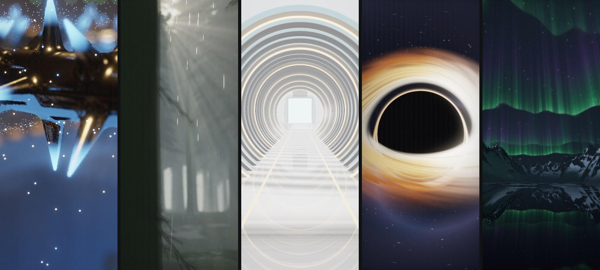
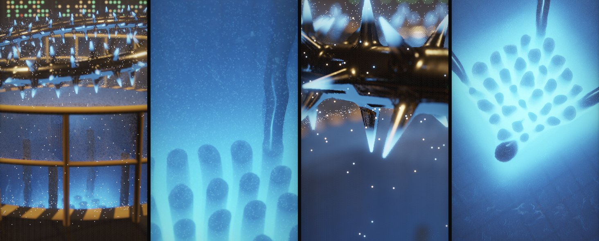
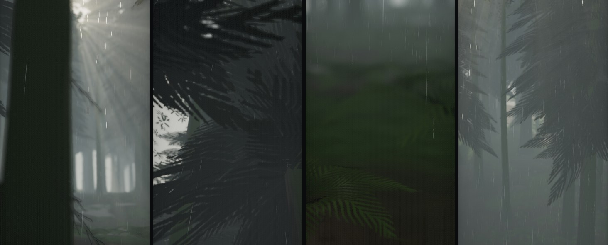
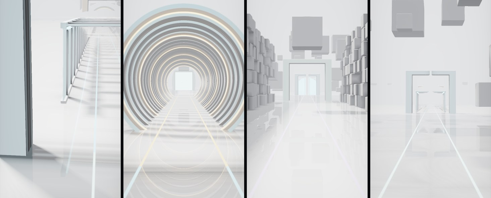
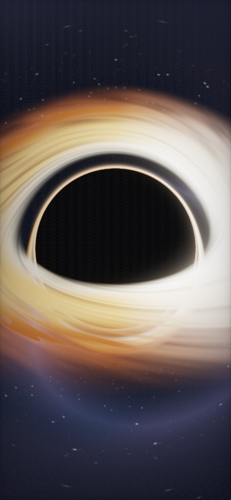
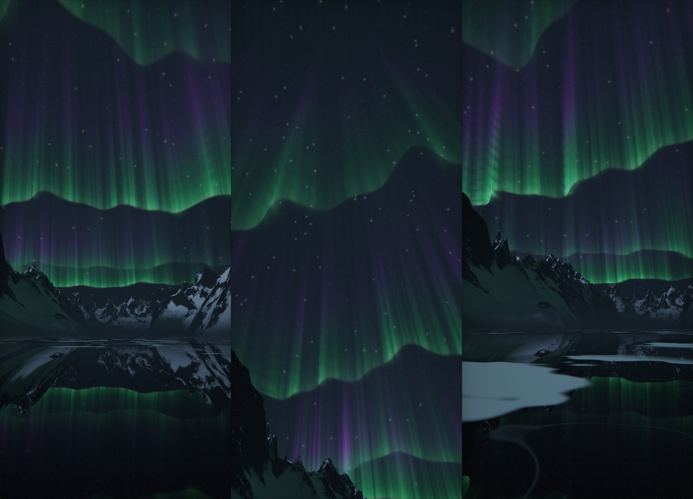
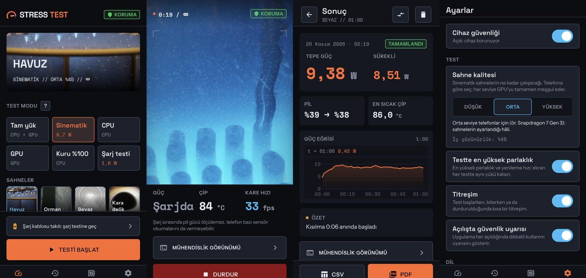

<div align="center">

# Stress Test

**Android telefonlar için stres testi ve benchmark: bir telefonun gerçekten çekebildiği en yüksek gücü bulmak, bunu yaparken de göze iyi görünmek için.**

[](https://github.com/OzcanOrhanDemirci/stress_test/actions/workflows/ci.yml)
[](https://github.com/OzcanOrhanDemirci/stress_test/actions/workflows/release.yml)
[](https://kotlinlang.org)
[](https://developer.android.com/compose)
[](app/src/main/cpp)
[](app/src/main/cpp/cpu)
[](app/src/main/cpp/gpu)
[](app/build.gradle.kts)
[](#referans-cihaz)
[](https://github.com/OzcanOrhanDemirci/stress_test/releases/latest)
[](LICENSE)

Referans telefonda tam yükte **10,1 W** · aynı çekirdeklerde "kuru %100"ün **2,6 katı** güç · üç kalitede beş sinematik sahne · şarj testi · cihaz güvenliği · PDF rapor

**[Son paketi indir](https://github.com/OzcanOrhanDemirci/stress_test/releases/latest)** · 64-bit Android 10 ve üstü · izin yok, hiçbir şey toplanmaz

[Kurulum](#kurulum) · [Uyumluluk](#uyumluluk) · [Soru](#soru) · [Sonuçlar](#sonuçlar) · [Modlar](#modlar) · [Şarj testi](#şarj-testi) · [Sahneler](#sinematik-sahneler) · [Uygulama](#uygulama) · [Cihaz güvenliği](#cihaz-güvenliği) · [Güç nasıl ölçülüyor](#güç-nasıl-ölçülüyor) · [Yük nasıl üretiliyor](#yük-nasıl-üretiliyor) · [Mimari](#mimari) · [Derleme](#derleme)

*[English](README.md)*

<br />



</div>

---

Stress Test, Android telefonun yük altında pilden çektiği gücü ve şarj olurken
pile giren gücü ölçer. Referans cihaz **Honor 400**. Aşağıdaki güç değerleri bu
telefonda ölçüldü ve stres testi yükleri bu ölçümlere göre seçildi.

> [!WARNING]
> Stress Test telefonu tam kapasitede çalıştırır ve telefon çok ısınır.
> Varsayılan olarak açık olan [cihaz güvenliği](#cihaz-güvenliği), pil, gövde ya
> da çip tehlikeli ölçüde ısınmadan testi durdurur; ama telefonun kendi
> sensörlerini okur ve koruma garanti edemez. Testi kılıfsız, düz ve serin bir
> yüzeyde çalıştır; uygulamayı kendi sorumluluğunda kullan: hiçbir garanti
> verilmez ([lisans](LICENSE)).

## Soru

Telefondaki stres testlerinin çoğu aynı şeyi gösterir: bütün çekirdekler %100.
Bu sayı bir çekirdeğin ne kadar meşgul olduğunu söyler, ne kadar çalıştığını
değil. Bir çekirdek birbirine bağlı tamsayı toplamalarıyla tamamen doldurulabilir
ve birimlerinin neredeyse hepsi boşta kalır. Aynı çekirdek, işlenenleri
önbellekten akan vektör çarp-topla komutlarıyla da doldurulabilir: aritmetik
birimler, yükleme yolu ve önbellek aynı anda çalışır. İkisi de %100 görünür.
Telefonu ısıtan yalnız biridir.

Bu, Cinebench ile Prime95 arasındaki farktır ve bu proje onu ölçer. Referans telefonda:

| Sekiz çekirdekte çalışan | Görünen yük | Pilden çekilen güç |
| --- | --- | --- |
| Birbirine bağlı tamsayı toplamaları (`dry`, "kuru %100") | %100 | **2,46 W** |
| FP32 çarp-topla, işlenenler L2'den akar (`fp32_l2`) | %100 | **6,39 W** |
| Aynısı, artı GPU'nun FP32 yakıcısı (**Tam yük**) | %100 + GPU %100 | **10,1 W** ¹ |

<sub>İlk iki satır aynı oturumdan, oda sıcaklığında: aynı %100, 2,6 kat güç.
¹ Daha sonraki bir oturumda, telefon metal bir yüzeyde ve vantilatörün önündeyken ölçüldü;
soğutma sürdürülebilen gücü artırır. O oturumda `fp32_l2` tek başına 7,10 W çekti.</sub>

Bu yüzden buradaki tek ölçüt **pilden çekilen güç, watt cinsinden**. Bir yük
ancak ölçülen hiçbir şey ondan fazla çekmiyorsa "en yüksek"tir. Telefonun kendi
denetleyicileri ne yaparsa onu yapar, sonuç ekranı ne zaman ve ne kadar
yaptıklarını gösterir. 0.2.0'dan beri uygulama telefonu varsayılan olarak da
korur ([cihaz güvenliği](#cihaz-güvenliği)): pil, gövde ya da çip tehlikeli ölçüde
ısınmadan testi durdurur. Kapatılınca tamamen kenara çekilir.

Aynı ders sonradan GPU'da da çıktı. Işın yürüten bir sahne GPU'yu %100 meşgul
eder ama 2,95 W çeker; aynı GPU'da FP32 çarp-topla yakıcısı 5,45 W çeker.
Meşgul olmak orada da çalışmak demek değil.

## Sonuçlar

Bütün değerler Android'in `BatteryManager`'ından okunan pil gücüdür; telefon
kabloya bağlı değilken, kendi kendine koşturduğu oturumlarda ölçüldü (bkz.
[Güç nasıl ölçülüyor](#güç-nasıl-ölçülüyor)). Her oturumun koşullarıyla birlikte
tam kayıt [docs/OLCUMLER.md](docs/OLCUMLER.md)'de.

**CPU çekirdek yükleri, sekiz çekirdekte, ilk 30 sn ortalaması, her biri rastgele sırayla iki kez, oda sıcaklığında:**

| Yük | Neyi çalıştırır | Güç |
| --- | --- | --- |
| `fp32_l2` | FP32 FMA, işlenenler 256 KiB'lık tampondan akar | **6,39 W** |
| `i8_mmla` | INT8 matris çarp-topla (SMMLA) | 5,27 W |
| `fp64_gemm` | FP64 FMA, L1'den 8×6 dış çarpım | 5,08 W |
| `mixed` | FMA, tamsayı zinciri, çarpıcı ve yazma aynı anda | 4,95 W |
| `bf16_mmla` | BF16 matris çarp-topla (BFMMLA) | 4,80 W |
| `fp32_dram` | FP32 FMA, işlenenler 32 MiB'tan akar | 4,76 W |
| `fp32_gemm` | FP32 FMA, L1'den 8×12 dış çarpım | 4,54 W |
| `memcopy` | 32 MiB kopyalama: saf bellek bant genişliği | 4,13 W |
| `i8_dot` | INT8 nokta çarpımı (SDOT) | 3,95 W |
| `fp32_reg` | Yalnız yazmaçta FP32 FMA | 3,93 W |
| `dry` | Birbirine bağlı tamsayı toplamaları | **2,46 W** |

İki şey öne çıkıyor. Gücü çeken yalnız aritmetik değil: yalnız yazmaçta çalışan
FMA, FMA birimlerini doldurduğu hâlde 3,93 W'ta kalıyor. Gücü getiren, verinin
taşınması. Tamponun da bir tatlı noktası var: aynı yük 128 KiB'ta 6,62 W,
**256 KiB'ta 7,10 W**, 512 KiB'ta 6,82 W çekiyor; 1 ve 2 MiB'ta ise 4,8 W'a
düşüyor, çünkü çekirdekler çoğunlukla belleği bekliyor. (Bu ikinci sayı dizisi
telefonun metal yüzeyde ve vantilatör önünde olduğu oturumdan; bir oturumun
içinde önemli olan sıralamadır.)

**GPU yakıcıları, tek başına:** FP32 ALU 5,57 W · FP16 ALU 3,70 W · harmanlama
3,09 W · doku örnekleme 3,03 W · bellek bant genişliği 2,73 W.

**Birlikte:** CPU'da `fp32_l2`, GPU'da FP32 yakıcısı ölçülenlerin en yükseği: iki
oturumda **10,09 W ve 10,13 W**. CPU ortak güç bütçesine biraz frekans bırakıyor
(A510 / A715 / prime yaklaşık 1,1 / 1,8 / 2,1 GHz'e oturuyor) ve toplam yine de
en yüksek kalıyor.

## Modlar

| Mod | Yük | Ekranda | Ölçülen |
| --- | --- | --- | --- |
| **Tam yük** | `fp32_l2` + GPU FP32 yakıcısı | yük kadranı (GPU yakıcıda) | **10,1 W** |
| **Sinematik** | `fp32_l2` + bir sahne | ana ekranda seçilen beş sahneden biri | havuzla 8,9 W |
| **CPU** | tüm çekirdeklerde `fp32_l2` | kadran | 7,1 W (soğutmasız 6,4 W) |
| **GPU** | GPU FP32 yakıcısı | yük kadranı | 5,5 W |
| **Kuru %100** | `dry` | kadran | 2,5 W (soğutmasız) |
| **[Şarj testi](#şarj-testi)** | telefon şarjda ve boşta | pil yüzdesine göre pile giren güç | telefona, şarj cihazına ve kabloya göre değişir |

<sub>"Soğutmasız" yazmayan stres testi değerleri Honor 400 metal yüzeyde ve vantilatör önündeyken ölçüldü.</sub>

Bir stres testi 1, 5, 15 ya da 30 dakika sürer, ya da durdurulana kadar. Önce 10 saniye
dinlenir ve telefonun hiçbir şey yapmazken çektiği gücü ölçer; ardından ekranı
her seferinde aynı biçimde, tam parlaklık ve en yüksek yenileme hızında sürer ki
testler karşılaştırılabilsin.

Sahnelerin Tam yükün arka planı değil ayrı bir mod olması ölçümle verilmiş bir
karar: sahne ekrandayken yakıcıya kare süresi kalmıyor ve tam yük 8,97 W'a,
yani en yüksek değerin %88,5'ine iniyor. Ölçümden önce yazılan kural %97 idi; bu
yüzden sahneler kendi modlarına taşındı ([docs/PLAN.md](docs/PLAN.md), §13/7).

İsteğe bağlı bir ayarla FP32 yakıcısı sinematik testlerde artan kare süresini
kullanabilir.

### Şarj testi

Şarj testi, pil akımını pil gerilimiyle çarpar ve pile ulaşan net gücü watt
cinsinden pil yüzdesine göre çizer. Şarj cihazı aynı zamanda telefonu besler ve
şarj devresindeki kayıpları karşılar. Test, şarj cihazının çıkış gücünü ve bu
kayıpları ölçemez.

**Şarj testi** modunu seç ve telefonu boşta bırak. 5, 15, 30 dakika ya da
**Dolana kadar** seçeneklerinden birini seç. **%20 ile %50** arasında başlarsan
telefon şarjı yavaşlatmadan önce farkı daha iyi görürsün. 20 saniyelik boşta
ölçümü için şarj cihazı takılı değilken başla ve uygulama isteyince bağla.
Pile güç girerken uygulama varsa boşta ölçülen gücü de ekler ve sonucu
**Telefona giren (tahmini)** diye gösterir. Şarj devresindeki kayıplar bu
tahmine girmez. Şarj cihazı takılıyken de başlayabilirsin. Testin gücü
gösterebilmesi için pil akımı ve gerilimi okunabilmeli.

Şarj cihazlarını veya kabloları kıyaslarken her seferinde birini değiştir,
benzer pil yüzdesi ve sıcaklığında başla, eğrilere aynı pil yüzdesinde bak.
Sonuçlar Geçmiş'e kaydedilir ve CSV olarak dışa aktarılabilir.

## Sinematik sahneler

Projenin yarısında eklenen ikinci hedef: *telefonun gösterebileceği en
etkileyici görüntü.* Orta kalitede her sahne ekran çözünürlüğünün %45'inde çizilir ve zamanla
tam çözünürlüğe kurulur: her kare örneklerini piksel altı bir kaymayla oynatır
ve rastgele etkilerini yeniden tohumlar; zamansal geçiş önceki kareleri kamerayla
yeniden hizalar ve yeni kareye göre kırpar; Catmull-Rom süzgeci sonucu ekrana
büyütür. Telefonun GPU'sunda yaklaşık 1 TFLOPS aritmetik ama yalnız yaklaşık
16 GB/s bellek bant genişliği var; bu yüzden her etki belleğe değil aritmetiğe
mal olacak biçimde seçildi.

### Havuz



Havuz güvertesinden görülen bir araştırma reaktörü. Tek bir tam ekran ışın
yürütme gölgelendiricisi salonu, dikenli muhafaza halkasını ve suyun altında
Çerenkov mavisiyle parlayan yakıt demetini çizer. Su yüzeyi, GPU'da saniyede 60
kez dalga denklemiyle çözülen 256 × 256'lık bir yükseklik alanı: çekirdeğin
üstünde patlayan kabarcıklar halka dalgalar başlatır, dalgalar kesişir, havuz
duvarından yansır, kontrol çubuğu tüplerinin çevresinde saçılır; yüzey ışığı
kırıp tabana kostik desenler düşürür. 16.384 GPU parçacığı (yükselen kabarcıklar,
halkanın çevresinde dönen kıvılcımlar), bloom, çekime göre alan derinliği ve bir
darbe: her döngüde bir kez reaktör bir TRIGA gibi parlar.

### Orman



Yağmurdan sonra ılıman bir yağmur ormanı. Havuzun aksine bu sahne geometri:
düzensiz bir ızgarada en çok 676 ladin ve kayın, dalları ve iğne demetleri,
eğreltiler ve devrik kütükler. Hiçbiri bellekte durmaz. Bir köşe gölgelendiricisi
her köşeyi çizimin ve örneğin numarasından kurar (köşe çekme), bir parça
gölgelendiricisi de her kartı bir iğne demetinin ya da yaprak kümesinin taslağına
göre keser. Güneşin gölge haritası bir kez çizilir; bir ışık geçişi her pikselin
ışınını sisin içinde bu haritaya karşı yürütür ve ışık huzmelerini çizer. 8.192
yağmur çizgisi huzmelerin içinde parlar, birikintilerde halkalar yayılır.

### Beyaz



Dramdan çok netlik üzerine: sonsuz bir beyaz boşluk, her şeyi yansıtan cilalı
bir zemin ve kesintisiz uçan bir kamera; asılı küplerin boşluğundan, cam bir
koridordan, kaburgalı cam bir tünelden ve duvarları üst üste küplerle örülmüş bir
odadan geçer. Cam ince ve soluk yeşil-mavidir, eğik bakıldıkça koyulaşır; böylece
arkadaki devasa beyaz dünya hep görünür kalır. Alan derinliği, renk saçılması ve
gren yok, bloom neredeyse yok; büyütmenin üstüne hafif bir keskinleştirme var.

### Kara delik



Diğer sahneler yüzeyleri yürütür; bu, her ışının düşüşünü bütünleştirir. Süper
kütleli bir kara delik derin uzayda yığılma diski yakar ve her piksel kendi
ışığını kara deliğin alanında adım adım sayar: ona doğru bükülür, çevresinde
dolanır, içine düşer. Bükülme resmin kendisidir: diskin uzak tarafı gölgenin
üstünde ve altında yükselir, ince bir yörünge halkası kenara yapışır, yıldızlar
kenarda ikilenir. Hiçbir şey depolanmaz, hiçbir şey örneklenmez; sahne,
bütünleştirmenin aritmetiğinden ibarettir (Runge-Kutta, uyarlanabilir adım,
yıldızlar ve diskin türbülansı için hash'ler). Kalite, düşüşün adım bütçesini,
piksel başına örnek sayısını, diskin türbülansını ve gökyüzünün yoğunluğunu
büyütür. Yüksek kalite adım sayısını iki kattan fazla artırır ve piksel başına
iki örnek alır. Yukarıdaki görsel, telefonun gölgelendiricilerini çalıştıran
masaüstü önizlemesinden.

### Kuzey ışıkları



Bir fiyortta kutup gecesi; kahramanı gökyüzü olan ilk sahne. Yeşil ve mor aurora
perdeleri karlı dağların ve yıldızların üstünde dalgalanır, durgun su ve kara
buz onları geri verir. Perdeler ince tabakalardır ve her ışının onların
içinden geçen yolu kapalı biçimde bütünleştirilir: düz bir çizgi boyunca
bakılan Gauss tabakası, iki hata fonksiyonunun farkıdır. Bu yüzden yandan
görülen bir kıvrım gerçeğindeki gibi daha parlak yanar ve hiçbir perde iki
adımın arasına düşüp kaybolamaz. Dağlar piksel başına yürütülen sırtlı bir
yükseklik alanıdır; alçak bir ay onları yumuşak gölgesiyle aydınlatır; su bütün
sahneyi yansıtır. İnce ayrıntı her pikselin kapladığı alana göre söner, böylece
kamera kayarken uzak sırtlar ve perdelerin ışınları titremez. Kalite perdelerin
adımlarını, dağların oktavlarını ve yürüme bütçesini büyütür; Yüksek piksel
başına iki örnek alır. Görseller telefonun gölgelendiricilerini çalıştıran
masaüstü önizlemesinden.

### Grafik kalitesi

Düşük kalite ekran çözünürlüğünün %30'unda, Orta %45'inde çizilir. Yüksek kalite
ayrıntıyı artırır ve sahneyi %65'te, ormanı ise %100'de çizer. Honor 400, 15
saniyelik ve yalnız sahnenin çalıştığı lab testlerinde beş sahneyi de seçilen
ayarlarda hatasız çizdi. Tablodaki süreler kare başına milisaniye cinsinden.
[Ölçüm kaydı](docs/OLCUMLER.md)

| Kalite | Havuz | Orman | Beyaz | Kara delik | Kuzey ışıkları |
| --- | ---: | ---: | ---: | ---: | ---: |
| **Düşük** | 25,9 | 26,7 | 20,3 | 12,9 | 19,2 |
| **Orta** | 48,5 | 41,4 | 38,7 | 25,3 | 46,9 |
| **Yüksek** | 295-311 | 137,6 | 174,2 | 122,3 | 336,6 |

Test başlarken uygulama, seçilen ayarların sürücüyü sıfırlatacak kadar uzun bir
kareye yol açıp açmayacağını yoklar. Kalite veya çözünürlük ölçeği düşerse canlı test
ve sonuç ekranında hangi ayarda çizildiği yazılır. Kayıt iki ayarı da saklar.
Bu test karşılaştırmaya girmez ve sonuçta Honor 400 referans satırı gösterilmez.

## Uygulama



Yeni arayüz canlı ölçümleri düz, koyu panellerde öne çıkarır. Dört sekmeden test
başlatabilir, Geçmiş'i açabilir, Cihaz'daki okumaları inceleyebilir veya Ayarlar'ı
değiştirebilirsin. Stres testi sırasında sahne ya da kadran canlı okumalarla
birlikte görünür. Sonuç ekranı tepe ve sürekli
gücü, ortalamayı, boştaki gücü, harcanan enerjiyi, pilin başını ve sonunu, bu
yükte tam bir pilin ne kadar dayanacağını, en sıcak çipi, CPU ve GPU iş hızlarını,
sahnenin kare hızını, kararlılığı ve hesap hatalarını gösterir; ardından düz
sözcüklerle bir **analiz** (telefon ilk ne zaman kısıldı, ilk dakikayla son dakika
arasında ne kadar hız verdi, çip ve pil ne kadar ısındı, pil ne hızla tükendi) ve
parmağın altında değerlerini okuyan güç, sıcaklık, frekans, iş ve kare hızı
grafikleri gelir. Karşılaştırmaya uygun stres testleri yan yana açılabilir.
Stres testi sonuçları iki sayfalık **PDF rapor** ya da **CSV** olarak dışa
aktarılabilir. Uygulamada o teste ait bir Honor 400 ölçümü varsa sonuçta referans
olarak gösterilir. Havuzun referans ölçümü Orta kalitede, ek yakıcı kapalıyken
alındı. Geçmiş son 200 testi saklar. Uygulama telefonun dilini izler.
Türkçe veya İngilizceyi Ayarlar'dan, Android 13 ve üstünde telefonun uygulama dili
ayarından da seçebilirsin.

## Kurulum

1. [Son sürümden](https://github.com/OzcanOrhanDemirci/stress_test/releases/latest) `stress-test-<sürüm>.apk` dosyasını
   indir.
2. Buradan geldiğinden emin olmak istersen neyle imzalandığına bak
   (sertifika [SECURITY.md](SECURITY.md#verifying-a-package)'de).
3. Telefonda aç; Android sorduğunda bu kaynaktan yüklemeye izin ver.

Telefon gereksinimleri [Uyumluluk](#uyumluluk) bölümünde. Uygulama hiçbir izin istemez
ve ağa çıkamaz. Bu kaynaktan yayın anahtarı olmadan derlenen paket debug
anahtarıyla imzalanır ve ikisi birbirini güncelleyemez: birini kurmadan önce
öbürünü kaldırmak gerekir, bu da onun test geçmişini siler.

## Uyumluluk

Stress Test, **Android 10 ve üstü** 64 bit ARM telefonlar (`arm64-v8a`) için
tasarlandı. Uyumluluk çalışması Snapdragon/Adreno'yu, Mali kullanan MediaTek ve
Exynos cihazları, Google Tensor'ı, Xclipse kullanan Exynos cihazları ve PowerVR
GPU'ları kapsıyor. Tam yük ve Sinematik dahil GPU kullanan testler için çalışan
bir Vulkan 1.1 veya üstü sürücü gerekiyor. Böyle bir sürücü yoksa CPU ve şarj
testleri yine kullanılabilir.

Uygulama pil akımının birimini ve yönünü okumalardan çıkarır, üreticiye göre
değişen sıcaklık bölgelerine ve performans sayaçlarına bakar, CPU komutları ile
Vulkan sürücülerindeki farklara uyum sağlar. Okunamayan ya da kullanılamayan
değerler **Yok** olarak gösterilir. **Cihaz** sekmesi bu telefonun hangi değerleri
verdiğini ve eksik okumanın nedenini söyler. Örneğin sürücü, GPU sayacını
uygulamaya açmayabilir.

**Gerçek telefonda denenen tek model Honor 400.** Diğer telefonların uyumluluğu
kod ve üreticiler arasındaki bilinen farklar üzerinden değerlendirildi. Cihaz
çiftliğinde ya da ücretli bir hizmette test yapılmadı.

## Cihaz güvenliği

Varsayılan olarak açık ve ayarlar ekranındaki ilk şey. Test sürerken uygulama
telefonu izler; bir değer üç saniye boyunca sınırının ötesinde kalırsa testi
durdurur. Test, nedeni ve ölçülen değerle birlikte saklanır.

| Durdurur | Uyarır | Şunun üstündeyken başlamaz |
| --- | --- | --- |
| pil 47 °C | 44 °C | 42 °C |
| CPU ya da GPU 110 °C | 105 °C | 80 °C |
| gövde 48 °C | 45 °C | 42 °C |
| Android termal durumu *ciddi* | *orta* | *ciddi* |
| pil %5 (pildeyken) | %10 | %10 |

Çip sınırı bilerek kısma noktasının üstünde: Honor'un çekirdeği CPU ve GPU
bölgelerini 95 °C'de kısmaya başlıyor (daha sert sınırları 110-115 °C, kritik
125 °C); 95 °C'de durdurmak her tam yük testini saniyeler içinde keserdi. Orada
her zaman tutmuyor da: bir tam yük testinde 37. saniyede GPU'nun kısmasını
kaldırıp 107 °C'ye çıkmasına izin verdi ve ilk sınır olan 105 °C o testi 43.
saniyede kesti. Durdurma artık telefonun kendi sert kademesinin başladığı 110 °C'de,
uyarı 105 °C'den itibaren: sınır, kendi koruması artık yetişemeyen bir telefon
için. Cihaz güvenliğini kapatmak önce sorar; kapalıyken uygulama hiç araya girmez
ve yalnız telefonun kendi koruması kalır. İlk gerçek durdurmada, şarjdaki bir
orman testi Android *ciddi* termal durum bildirince 2:36'da bitti; sahibinin bu
özellik yokken yaptığı 34 dakikalık tam yük testi pili 43 °C'den 55 °C'ye
çıkarmıştı.

Uygulama her açıldığında bir uyarı bunu açıkça söyler: test telefonu tam
kapasitede çalıştırır ve çok ısıtır, cihaz güvenliği koruma garanti edemez,
sorumluluk kullanıcınındır. Uyarı ancak onaylanınca kapanır; "Bir daha gösterme"
onu kapatır, ayarlar yeniden açar.

## Güç nasıl ölçülüyor

Telefon, bir uygulamaya pilinin sysfs dosyalarını açmıyor; tek kaynak
`BatteryManager`. Referans telefondaki alanlarına güvenmeden önce onları ölçmek gerekti:

- `CURRENT_NOW` **miliamper** cinsinden (mikroamper değil), boşalırken eksi,
  saniyede bir güncelleniyor. Uygulama birimi ve işareti varsaymıyor, okumalardan
  çıkarıyor.
- `CHARGE_COUNTER` **miliamper-saat** cinsinden (mikroamper-saat değil) ve
  yaklaşık 30 saniyede bir değişiyor; voltaj yalnız pil yayınıyla, yaklaşık aynı
  sıklıkta geliyor. Buradaki bir birim varsayımı bir keresinde pil ömrü tahminini
  bin kat yanlış yapmıştı.
- Kablo takılıyken alınan örnekler pilden çekilen gücü ölçmek için geçersiz.
  [Şarj testi](#şarj-testi) gücü ters yönde ölçer.

Bir örnekleyici gücü, bütün termal bölgeleri, her kümenin frekansını ve GPU'nun
meşguliyet sayacını saniyede on kez okuyor ve sınırlı bir kayıt tutuyor.

**Yükleri adil karşılaştırmak** kablonun çıkmasını gerektiriyor (şarj olan bir
pil telefonun ne çektiğini söylemez) ve referans telefon kablo çıktığı anda TCP
üzerinden de kablosuz hata ayıklamayla da adb bağlantısını düşürüyor. Bu yüzden
karşılaştırmalar telefonun kendi kendine koşturduğu **lab oturumları** olarak
yapılıyor: `tools/lab.mjs` oturumu kablo üzerinden başlatıyor, telefon kablonun
çıkarılmasını bekliyor, ardından her yük için rastgele sırayla CPU'ların belirli
bir sıcaklığın altına inmesini bekliyor, 10 saniye dinlenirken ve 60 saniye yük
altında ölçüyor ve örnekleri kaydediyor. Kablo geri takılınca `lab.mjs pull` ve
`report` sonuçları çekip sıralıyor.

## Yük nasıl üretiliyor

**CPU.** On bir yük ve kazananın dört tampon boyu türevi; hepsi bir üretici
(`tools/gen_kernels.py`) tarafından AArch64 assembly olarak yazılıyor, böylece
her birinin imzası ve disiplini aynı:

- Her iterasyon grubu sonuçlarının bir **özetiyle** biter ve bu özet altın bir
  değerle karşılaştırılır. Yanlış hesap yaparak telefonu ısıtan bir yük
  yakalanır: hesap hataları sayılır ve her testte gösterilir.
- İşçiler kendi çekirdeklerine **sabitlenir**. Qualcomm'un `core_ctl`'ü büyük
  çekirdekleri boştayken, bazen yük altında da park ediyor; bu yüzden sabitleme
  her grupta yeniden denenir ve yanlış çekirdekte çalışan gruplar sayılır.
- Bir yük metin olarak yazılır, `0-3:i8_mmla,4-7:fp32_l2+gpu_fp32`; aynı metin
  uygulamanın modlarını, lab oturumlarını ve testleri sürer.

**GPU.** Beş yakıcılı bir Vulkan 1.1 motoru (varsa 1.2 özellikleriyle): FP32 ve FP16 aritmetik, doku
örnekleme, bellek bant genişliği ve harmanlama. Aynı anda üç kare uçuşta tutulur;
üç zaman damgası her kareyi yakıcı süresi ve görünen geçiş süresi olarak böler ve
yakıcının gönderim sayısı her karede, yakıcı ile sahne birlikte hedef kare
süresini dolduracak biçimde ayarlanır. Her gönderimin sonuçları ilkine karşı
denetlenir. Bir sürücü davranışı bir gölgelendiriciyi ikiye bölerek bulunmak
zorunda kaldı: Adreno 720 sürücüsü, depolama tamponundan bütün bir yapıyı
kopyalayan compute boru hattını reddediyor (`VK_ERROR_UNKNOWN`);
`particle_params.glsl` bunu açıklıyor ve kurulamayan her boru hattı artık
kayıtta adıyla görünüyor.

## Mimari

```
app/src/main
├── java/dev/ozcan/stress
│   ├── engine/      CPU ve GPU motorları, yük dili, sahne kalitesi
│   ├── telemetry/   10 Hz örnekleyici, pil ve termal okuyucular, sysfs düzeni, çekirdek adları
│   ├── device/      telefonun ne olduğu: yonga seti, kümeler, GPU, Vulkan sürümü
│   ├── analysis/    güç, pencereli istatistik, iş hızları, bulgular, karşılaştırmalar
│   ├── safety/      cihaz güvenliği: sınırlar, bulgular, izleyici
│   ├── settings/    kullanıcının seçimleri
│   ├── run/         bir stres testi: modlar, denetleyici, analiz, kayıtlar ve depoları
│   ├── charge/      şarj koşuları, pil gücü ve analiz
│   ├── report/      PDF rapor ve CSV
│   ├── lab/         kendi kendine çalışan karşılaştırma oturumları: tarif, çalıştırıcı, analiz, CSV
│   └── ui/          Compose: gezinme, bileşenler, ana, test, sonuç, şarj, karşılaştırma, geçmiş, ayarlar, cihaz
└── cpp
    ├── cpu/         yükler (üretilmiş AArch64 assembly), tabloları, işçi iş parçacıkları
    ├── gpu/         Vulkan yardımcıları, yakıcı motoru, sinematik sahne çizicisi
    │   └── shaders/ GLSL: yakıcılar, beş sahne, TAA, bloom, alan derinliği, son işlem
    ├── sense/       termal bölgeler, frekanslar ve GPU meşguliyet sayacı için yerel okuyucu
    └── jni_bridge.cpp
tools/
├── gen_kernels.py   yüklerin assembly'sini yazar
├── lab.mjs          lab oturumlarını başlatır, sonuçlarını çeker, sıralar
└── scene_preview.py sahneleri geliştirme makinesinin GPU'sunda çizer
docs/
├── PLAN.md          plan, cihazın ölçülmüş gerçekleri, her karar ve gerekçesi
└── OLCUMLER.md      her ölçüm, koşullarıyla
```

Sahne gölgelendiricileri, telefonun çizicisinin ve bir masaüstü önizlemesinin
paylaştığı düz GLSL. `tools/scene_preview.py` telefonun kendi
gölgelendiricilerini geliştirme makinesinin GPU'sunda OpenGL ile çalıştırıyor:
sahneyi, su simülasyonunu ve parçacıkları, bloom zincirini, alan derinliğini ve
son geçişi, telefonun çözünürlüğünde. Gösterdiği şey, telefonun ekran
görüntüleriyle her karşılaştırıldığında tuttu; böylece bir sahnenin görünüşü
telefon olmadan üzerinde çalışılabildi, telefon ise doğrulamak ve ölçmek için
kullanıldı.

## Okunmaya değer kararlar

Hepsi, karara varan ölçümle birlikte [docs/PLAN.md](docs/PLAN.md)'nin 13.
bölümünde tam olarak yazılı; ölçümlerin kendisi [docs/OLCUMLER.md](docs/OLCUMLER.md)'de.

| | |
| --- | --- |
| **Tek ölçüt: watt** | "%100" değil, puan değil. Bir yük ancak pilden ölçülen daha fazla güç çekerek kazanır. |
| **Bir referans telefondan 64 bit Android'e (0.2.0)** | Uygulama, Honor 400'de seçilen yükleri koruyup her telefonun çekirdek düzenini ve sensörlerini bulur. |
| **Cihaz güvenliği, varsayılan açık (0.2.0)** | "Koruma yok"un yerini aldı. Sınırlar telefonun kısma noktasının üstünde; kapatmak onaylanan bir seçim. |
| **Yanında götürülen rapor (0.2.0)** | "Dışa aktarma yok"un yerini aldı: analiz telefonda kalır, PDF ya da CSV dışarı çıkabilir. |
| **Sahneler ayrı mod** | Sahne, ölçümden önce yazılan %97 kuralına karşı tam yükün %88,5'ini çekti. |
| **Hesap ağır, bellek hafif etkiler** | Ölçülen ~1 TFLOPS'a karşı ~16 GB/s: büyük dokular değil; ışın yürütme, prosedürel geometri, bir kez çizilen gölge haritası. |
| **Stres testlerinde kadran** | Dört sahnesi olan uygulamanın görünümü ilk sahne olan reaktör havuzuyla sınırlı kalmaz. |
| **Çip dışı yükler kullanıcıya bırakıldı** | Fener, modem ya da kamera test sırasında elle açılabilir; tarifler çipin üstünde kalır. |

## Neler doğrulandı

```bash
./gradlew testDebugUnitTest            # JVM testleri
./gradlew lintDebug                    # Android Lint, hata derlemeyi düşürür
./gradlew connectedDebugAndroidTest    # bağlı telefonda testler
```

JVM testleri pil gücünü, akımın birimini ve yönünü, şarj testinin adımlarını ve
analizini, üreticilerin sensör adlarını, güvenlik sınırlarını, test hatalarını,
karşılaştırmayı, CSV'yi ve eski kayıtların açılmasını kapsıyor. Okuma düzeltmeleri
arşivdeki 104 Honor 400 lab testinin verileri yeniden işlenerek de sınandı.

Bağlı telefonda çalışan testler CPU hesaplarını, GPU yakıcılarını, sahne
çizimini, sensörlerin bulunmasını ve yük tariflerini sınar. 0.3.0 lab
testlerinde Honor 400 dört sahneyi de Düşük, Orta ve Yüksek'te seçilen ayarlarda
hatasız çizdi; 0.3.0'dan sonra eklenen kuzey ışıkları da öyle. Diğer modellerin
uyumluluğu kâğıt üzerinde değerlendirildi.
Şarj testi otomatik testlerle sınandı. Gerçek şarj cihazı ve kablolarla ölçüm
henüz yapılmadı. [Ölçüm kaydı](docs/OLCUMLER.md)

Uyarılar her yerde hata sayılıyor: Kotlin, C++ (`-Wall -Wextra -Wshadow
-Wconversion -Werror`) ve gölgelendirici derleyicisi (`glslc -Werror`).

Derleme, JVM testleri ve Lint, CI'da sabit NDK sürümüyle çalışır. Telefon
testleri için bağlı bir cihazda ayrı bir çalıştırma gerekir. [CI iş akışı](.github/workflows/ci.yml)

## Derleme

```bash
git clone https://github.com/OzcanOrhanDemirci/stress_test.git
cd stress_test
./gradlew :app:installRelease
```

Gradle için CI'da kullanılan JDK 21'i, Android SDK Platform 37.1'i, NDK
29.0.14206865'i ve CMake 4.1.2'yi kullan. Gölgelendiriciler NDK'nın `glslc`
aracıyla derlenir. Derleme yalnız `arm64-v8a` içindir ve `minSdk` 29'dur
(Android 10).

Sürüm derlemesi, hiç commit edilmeyen bir anahtarla imzalanır; anahtar ya git'in
yok saydığı `keystore.properties`'ten ya da ortam değişkenlerinden okunur. İkisi de
yoksa sürüm derlemesi debug anahtarıyla imzalanır; böylece herkes bu depoyu
klonlayıp çalışan bir paket üretebilir. Üretemeyeceği tek şey, yayınlanmış bir
kurulumu güncelleyebilen pakettir.

### Referans cihaz

| | |
| --- | --- |
| Telefon | Honor 400 (DNY-NX9), Android 16 |
| Yonga | Qualcomm Snapdragon 7 Gen 3 (SM7550) |
| CPU | 4 × Cortex-A510 1,8 GHz · 3 × Cortex-A715 2,4 GHz · 1 × Cortex-A715 2,63 GHz |
| GPU | Adreno 720, Vulkan 1.3 |
| Ekran | 1264 × 2736, 60 / 90 / 120 Hz |

### Araçlar

```bash
node tools/lab.mjs start --loads "dry;fp32_l2;fp32_l2+gpu_fp32@preview" --repeat 2   # kablo takılı, sonra çıkar
node tools/lab.mjs pull && node tools/lab.mjs report                               # kablo geri takılınca
python tools/scene_preview.py --scene white --times 3,18,30,44                     # moderngl, pillow, numpy
```

## Teknoloji

| Konu | Seçim |
| --- | --- |
| Uygulama | Kotlin 2.4.20, Material 3 ile Jetpack Compose, coroutines, kotlinx.serialization, Space Grotesk, Instrument Sans ve Space Mono |
| Yerel kod | NDK ve CMake üzerinden C++20 ve AArch64 assembly, JNI |
| Grafik | Vulkan 1.1 (varsa 1.2 özellikleri), derleme sırasında SPIR-V 1.3'e derlenip gömülen GLSL |
| Derleme | Gradle 9.8.0, Android Gradle Plugin 9.4.1 |
| SDK | derleme 37.1, hedef 36 (Android 16), en düşük 29 (Android 10) |
| Araçlar | Node.js (lab oturumları), moderngl ile Python (sahne önizlemesi, yük üretici) |

## Yayın

Bir etiket göndermek derler, test eder, imzalar ve yayınlar:

```bash
git tag -a v0.3.0 -m "Stress Test 0.3.0" && git push origin v0.3.0
```

İş akışı, `gradle.properties`'te yazılı sürümle uyuşmayan bir etiketi ya da
değişiklik günlüğünde bölümü olmayan bir sürümü yayınlamaz; bitmiş paketten
sertifikanın özetini okur ve yayın anahtarınınki değilse durur. Her sürüm
[CHANGELOG.md](CHANGELOG.md)'de; imzalama anahtarına ne olduğu dahil bütün yol
[docs/RELEASE.md](docs/RELEASE.md)'de.

## Bu depoda çalışmak

| | |
| --- | --- |
| [CONTRIBUTING.md](CONTRIBUTING.md) | Commit biçimi, ölçümler, bir pull request'in söylemesi gerekenler ve "bitti demeden telefonda çalıştır" kuralı. |
| [CHANGELOG.md](CHANGELOG.md) | Yayınlanan her sürüm ve neyin değiştiği. |
| [SECURITY.md](SECURITY.md) | Uygulamanın nelere erişebildiği ve bir sorunun gizlice nasıl bildirileceği. |
| [CODE_OF_CONDUCT.md](CODE_OF_CONDUCT.md) | Contributor Covenant. |
| [docs/RELEASE.md](docs/RELEASE.md) | Bir sürümün nasıl çıkarıldığı ve anahtara ne olduğu. |
| [docs/DESIGN.md](docs/DESIGN.md) | 0.3.0 arayüzünün tasarımı. |
| [docs/FDROID.md](docs/FDROID.md) | F-Droid yolu ve yeniden üretilebilir derleme. |
| [docs/NPU.md](docs/NPU.md) | Plandaki 6. fazın NPU yükü taslağı. |
| [docs/PLAN.md](docs/PLAN.md) | Plan, referans telefonun ölçülmüş gerçekleri ve her karar. |
| [docs/OLCUMLER.md](docs/OLCUMLER.md) | Koşullarıyla birlikte her ölçüm. |

Referans telefon dışındaki telefonlardan gelen ölçümler özellikle değerli: onlar
için bir issue formu var. Katkı belgeleri İngilizcedir.

## Durum

**Kaynak kodun sürümü 0.3.0.** Bu sürümle yeni arayüz, şarj testi, kara delik
sahnesi ve telefonlar arasındaki farklara yönelik düzeltmeler geliyor.
[Değişiklik günlüğü](CHANGELOG.md#030--2026-11-26)

## Lisans

MIT. Bkz. [LICENSE](LICENSE). Space Grotesk, Instrument Sans, Space Mono ve
PDF'teki JetBrains Mono, SIL Open Font License 1.1 ile kullanılıyor. Lisans
metinleri için [docs/licenses](docs/licenses) klasörüne bak.

## Yazar

**Özcan Orhan Demirci** · Flutter ve Android geliştirici, İzmir ·
[github.com/OzcanOrhanDemirci](https://github.com/OzcanOrhanDemirci)
